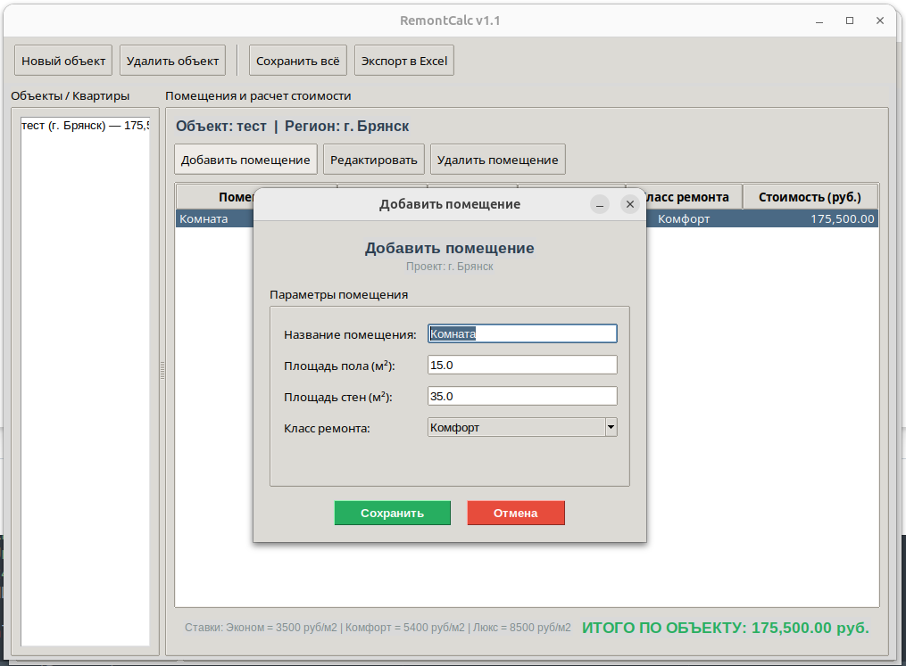
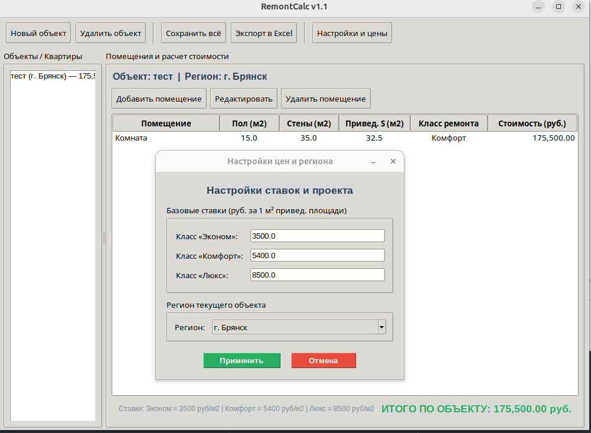

# 🏠 RemontCalc v1.1


**RemontCalc** — десктопное приложение на Python для быстрого и точного расчета стоимости ремонтных и отделочных работ с детализацией по помещениям, гибкими коэффициентами и выгрузкой готовой сметы в Excel.

Приложение создавалось с учетом реальной практики работы на строительных объектах: минимум лишних кликов, мгновенный пересчет, клавиатурная навигация и автоматическое резервное копирование данных.

---

## ✨ Основные возможности

- **📁 Управление объектами (проектами):** создание, редактирование, удаление и хранение базы квартир/объектов в локальном JSON-хранилище.
- **📐 Детализация по помещениям:**
  - Расчет приведенной площади по формуле: `S_привед = S_пола + (S_стен × 0.5)`.
  - Выбор класса ремонта для каждой комнаты отдельно (**«Эконом»**, **«Комфорт»**, **«Люкс»**).
  - Учет региональных коэффициентов.
- **⌨️ Удобный ввод данных (`RoomDialog`):**
  - Валидация числовых полей в реальном времени.
  - Быстрая навигация по клавишам `Tab` / `Shift+Tab` / `Enter` и изменение площади стрелками `↑` / `↓` с шагом `0.5 м²`.
- **📊 Экспорт сметы:**
  - Формирование структурированного отчета в **Excel (`.xlsx`)** с разбивкой по помещениям и итоговыми суммами.
  - Экспорт и импорт резервных копий проектов в **JSON**.
- **🛡️ Отказоустойчивость:** встроенная система логирования (`logs/`), автосохранение и автоматическое создание бэкапов перед перезаписью данных.

---

## 🖼️ Скриншоты интерфейса

> *Чтобы скриншоты отображались на GitHub, сохраните снимки экрана главного окна и окна добавления комнаты в папку `docs/screenshots/` под именами `main_window.png` и `room_dialog.png`.*

| Главное окно приложения | Добавление / редактирование помещения |
| :---: | :---: |
|  |  |

---

## 🏗️ Архитектура проекта

```text
remont_app/
├── main.py                  # Точка входа, конфигурация, DataManager и экспорт в Excel
├── RoomDialog.py            # Диалоговое окно ввода и валидации параметров помещения
├── config/
│   ├── prices.py            # Базовые расценки по классам ремонта и региональные коэффициенты
│   └── settings.py          # Пользовательские настройки интерфейса
├── models/
│   ├── project.py           # Модель объекта (квартиры) и агрегация стоимости
│   └── room.py              # Модель отдельного помещения и расчет приведенной площади
├── src/
│   ├── main_gui.py          # Основной графический интерфейс (Tkinter / Treeview)
│   ├── project_manager.py   # Управление коллекцией проектов
│   ├── room_manager.py      # Агрегация помещений по проектам
│   └── cost_calculator.py   # Движок расчета сметной стоимости
└── docs/
    └── screenshots/         # Скриншоты для документации
```

---

## 🚀 Установка и запуск

### 1. Клонирование репозитория
```bash
git clone https://github.com
cd RemontCalc
```

### 2. Создание виртуального окружения и установка зависимостей
Для работы основного интерфейса используются стандартные модули Python (`tkinter`, `json`, `logging`). Для выгрузки смет в Excel необходима библиотека `openpyxl`:

```bash
python3 -m venv venv
source venv/bin/activate  # Для Linux / macOS
# venv\Scripts\activate   # Для Windows

pip install openpyxl
```
*(Примечание для Ubuntu/Debian: если `tkinter` не установлен в системе, выполните `sudo apt install python3-tk`).*

### 3. Запуск приложения
```bash
python3 main.py
```

---

## ⌨️ Горячие клавиши

| Комбинация | Действие |
| :--- | :--- |
| `Ctrl + N` | Создать новый объект |
| `Ctrl + S` | Сохранить все проекты |
| `F5` | Обновить интерфейс и пересчитать данные |
| `↑` / `↓` (в полях площади) | Увеличить / уменьшить значение на `0.5 м²` |
| `Ctrl + Q` | Выход из программы |

---

---

## 🗺️ План развития (Roadmap)

- [x] Базовый расчет стоимости по помещениям с учетом приведенной площади (`S_пола + S_стен × 0.5`)
- [x] Валидация ввода и клавиатурная навигация (`RoomDialog`)
- [x] Редактор ставок и региона объекта из графического интерфейса (`SettingsDialog`)
- [x] Автосохранение проектов в JSON и экспорт сметы в Excel (`.xlsx`)
- [ ] Расширенный диалог создания проекта (`ProjectDialog`) с шаблонами типовых квартир
- [ ] Справочник состава работ по классам ремонта (`RepairClass`)

---

## 📄 Лицензия

Проект распространяется под свободной лицензией **MIT** — вы можете свободно использовать, модифицировать и развивать код под свои задачи.
